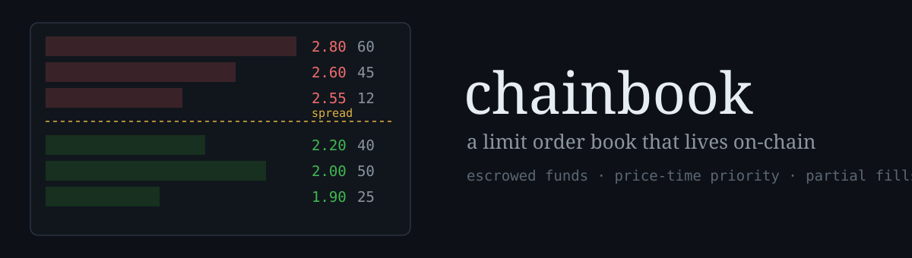

<p align="center">
  
</p>

<p align="center">
  <a href="https://github.com/SachuJames/chainbook/actions/workflows/test.yml"></a>
  
  
  
</p>

Most order books live on a server somewhere, with a database keeping score and an operator you have to trust. chainbook puts the whole book in one Solidity contract instead: orders, escrow, matching, settlement. Anyone can read the book, anyone can check the escrow, and a fill either happens on-chain or it does not happen at all.

The trade-off is gas, and this repo does not pretend otherwise. What you get in return is a book with no operator: no matching engine to run, no admin key that can rewrite history, no withdrawal queue. It is a small, honest version of the thing, built to be read.

## How matching works

The book trades one pair, fixed when the contract is deployed: a base token and a quote token (both ERC-20). Prices are quote per one whole base token, scaled by 1e18. A price of `2.5e18` means 2.5 quote for 1 base.

Placing an order escrows the funds up front:

- `placeBuy(price, amount)` pulls in `amount * price / 1e18` of quote.
- `placeSell(price, amount)` pulls in `amount` of base.

A new order first tries to match against the opposite side, best price first and first-in-first-out inside each price level. Fills settle immediately at the **maker's price**, so a taker who crosses the spread keeps the difference: whatever escrow is left over after a full fill goes straight back. Anything unfilled rests in the book with its escrow locked behind it, and `cancelOrder` refunds whatever is left.

One rule worth knowing: an order never fills against the same account's resting orders. If your own ask is the only thing your bid crosses, the bid just rests. Wash trading yourself would only burn gas.

Quote costs round down. A resting buy pays each fill out of its own escrow (locked amount minus the cost of what remains), so the dust from rounding stays with the maker and leaves on the final fill or a cancel. The contract never owes out more than it holds, and the fuzz test below checks that after every random sequence it is left holding exactly its obligations.

## A worked example

This is the ladder the deploy script seeds, and the demo under [Quickstart](#quickstart) runs it for real on a local node:

| side | price | amount | placed by |
| --- | --- | --- | --- |
| bid | 2.0 | 50 BASE | account 0 |
| bid | 2.2 | 40 BASE | account 0 |
| ask | 2.6 | 45 BASE | account 1 |
| ask | 2.8 | 60 BASE | account 1 |

Best bid 2.2, best ask 2.6. Now account 0 buys 20 BASE at 2.6. The bid crosses the best ask and fills at the maker's price: account 0 receives 20 BASE, account 1 receives 52 QUSD, and 25 BASE stays resting at 2.6. Had the same buy been willing to pay 3.0, it would still have filled at 2.6 and the extra escrow would have come back.

## Quickstart

You need [Foundry](https://getfoundry.sh).

```sh
forge test        # 22 unit tests plus the fuzz invariant
make demo         # fresh anvil, seeded ladder, one crossing trade
```

`make demo` prints the book after seeding, runs the worked example above through `cast`, and shows the balances before and after.

## Gas

Figures from `forge test --gas-report` (forge 1.8.5, October 2026, a small cloud VM; the full table is in `.gas-snapshot`). Across the suite, `placeBuy` lands at a median of about 351k gas, `placeSell` at about 340k, and `cancelOrder` at about 104k. Those medians include placements that match and settle fills along the way: posting into an existing level on a quiet book costs less, and an order that walks several levels costs more. Storage writes dominate everything, which is the basic fact of building a book on-chain.

## What this design costs

Price levels live in a sorted linked list, and inserting a new price walks that list from the best price until it finds its slot. So placement gets more expensive as the number of distinct resting prices grows: fine for dozens of levels, painful for thousands. The FIFO queues inside a level are constant time, it is the level walk that scales.

A production book would not do it this way. It would keep the book off-chain or in a denser structure and settle on-chain, or use a batch auction so order within a block stops mattering. Those are different systems with their own trust questions, which is rather the point of building this one plainly.

## Deploying

Locally, `make demo` is the whole story. For Sepolia, the deploy script is ready and the flow is one command once a deployer is funded:

```sh
export SEPOLIA_RPC_URL=<your rpc>
export DEPLOYER_KEY=<funded deployer key>
make deploy-sepolia
```

The Makefile has the matching `forge verify-contract` line for source verification. The script deploys the two mock tokens and the book, mints demo balances, and seeds the ladder from the worked example (`SEED=false` deploys bare contracts). The script's default keys are the public anvil development accounts; set the env vars to use anything else.

This repo has not been deployed to Sepolia yet: every public faucet route needs either a browser session, a login, or a mainnet balance, so the testnet run is waiting on test ETH rather than on code. The anvil demo above is the verified deployment path.

## Layout

```
src/ChainBook.sol       the book: escrow, matching, settlement
src/mocks/MockERC20.sol mintable ERC-20 for demos and tests
script/Deploy.s.sol     tokens + book + seeded ladder
script/demo.sh          the anvil demo behind make demo
test/                   unit tests, plus a fuzz test for the escrow invariant
```

## Honest limits

- One pair per contract, limit orders only. No market orders, no stop orders.
- No fees anywhere. A real venue would charge them; here they would only muddy the accounting.
- The tokens in the demo are mocks with a public mint. They are worth nothing and teach nothing about token safety beyond the standard checks.
- The book has not been audited. It has tests, a fuzz invariant, reentrancy guards, and plain accounting, which is not the same thing.
- Gas makes this a poor fit for a busy pair. It suits a slow, thin market, or a classroom, better than a trading floor.

## License

MIT.
